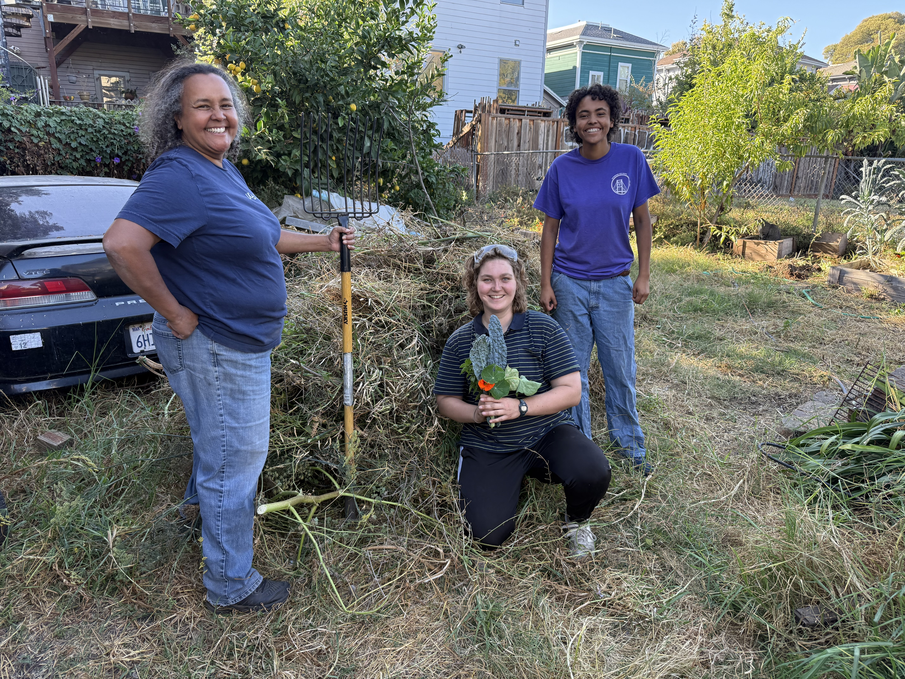

<h1 style="position: absolute; bottom: 0px; width: 100%; text-align: center; color: white; 
    text-shadow:
    -1px -1px 0 #000,
    1px -1px 0 #000,
    -1px 1px 0 #000,
    1px 1px 0 #000; font-size: clamp(1em, 8vw,3em); ">Welcome to Tenth Point</h1>

Tenth Point is a community garden nonprofit in West Oakland. Our first location is at 1009 Chester Street, where we are
beginning to build a presence and community in the neighborhood. We grow free fruits and vegetables year round. Stop by
anytime to harvest or hang out with us! Look out for upcoming workshops and events or check out [our calendar](/get-involved).

## What's Growing Right Now?

Blank space

## Address
1009 Chester Street, Oakland, CA 94607

## Contact us
[info@tenthpoint.org](mailto:info@tenthpoint.org)
